# Data Model: Tool approval denial reasons

**Feature**: [spec.md](./spec.md) | **Research**: [research.md](./research.md)

No new entity or entity ID. The feature extends the existing `ToolApproval` aggregate
(`internal/domain/storage/tool_approval.go`) with one value object, one delivery timestamp, and a
delivery-pending flag (Proposed: DB-048).

## ToolApproval (aggregate root, extended)

| Field | Type | Rule |
|---|---|---|
| `DenialReason` | `*DenialReason` (`denial_reason TEXT NULL`) | Set only by `Deny`, in the same transition as `Status=denied`. Never set for pending or approved records. Never changed afterwards. |
| `DenialDeliveredAt` | `*time.Time` (`denial_delivered_at TIMESTAMPTZ NULL`) | Set once by `ClaimDenialDelivery` when the broker claims the denied outcome for delivery. Only for denied records; this is not an agent acknowledgement. |
| `DenialDeliveryPending` | `bool` (`denial_delivery_pending BOOLEAN NOT NULL DEFAULT FALSE`) | Set true only by a new pending → denied decision. Claim and permanent revocation atomically clear it. False for historical records, without inferring an old denial or revocation. |

All existing fields and their meaning are unchanged, including `Persistence`, `ParamsPattern`
clearing on permanent denial, `ExpiresAt`, and `RevokePermanent`.

### Invariants

1. `DenialReason != nil` ⇒ `Status == denied` (FR-005).
2. `DenialReason` is set at most once, by the pending → denied transition; later `Deny` calls fail
   with `ErrApprovalNotPending` and leave it unchanged (FR-006).
3. `DenialDeliveredAt != nil` ⇒ `Status == denied`.
4. A record is **deliverable** at time `now` for invocation `(principal, agent, tool, argsHash)`
   when: `Status == denied`, `ApprovedAt == nil`, `DenialDeliveredAt == nil`, `DenialDeliveryPending == true`,
   `now < ExpiresAt`, and the four values equal the record's `Principal`, `AgentID`, `ToolName`,
   and `ArgumentsHash` (DEC-DELIVERY).
5. Claiming delivery sets `DenialDeliveredAt = now` and clears `DenialDeliveryPending`. Claim
   and permanent revocation are the only mutations after denial; neither changes `DenialReason`.
6. `DenialDeliveryPending` ⇒ `Status == denied`, `ApprovedAt == nil`, and
   `DenialDeliveredAt == nil`. Revocation clears pending delivery without inventing a delivery
   timestamp. Historical rows default to false, because their temporary-denial and revoked-denial
   states cannot be distinguished reliably. Revocation and claim serialize under the same row/write lock. If revocation commits first, a claim cannot succeed;
   if the claim commits first, its response may already be in flight and is not recalled.
7. Deliverability is not authorization precedence: the ExtProc gate skips temporary-denial
   delivery when a valid matching approval authorizes the repeat (FR-009). Permanent denials
   still block first. The claim endpoint checks record eligibility, not the gateway's matching
   approval snapshot.

### State transitions

```mermaid
stateDiagram-v2
    [*] --> pending: CreatePendingApproval
    pending --> approved: Approve (no reason)
    pending --> denied_undelivered: Deny(persistence?, reason?)
    denied_undelivered --> denied_delivered: ClaimDenialDelivery (original invocation, before expires_at)
    denied_undelivered --> denied_undelivered: later invocation / after expires_at (no change)
    approved --> denied_revoked: RevokePermanent (existing; never deliverable, approved_at set)
    denied_undelivered --> denied_revoked: RevokePermanent of permanent denial (persistence and delivery_pending cleared)
    denied_delivered --> denied_revoked: RevokePermanent of permanent denial (delivered_at retained, delivery_pending cleared)
```



The reason survives every transition after denial, including revocation, and is returned on
every owner read of that record.

## DenialReason (value object, new)

| Aspect | Rule |
|---|---|
| Constructor | `storage.NewDenialReason(raw string) (*DenialReason, error)` |
| Absence | `""` or only `unicode.IsSpace` runes → `nil, nil` |
| Retention | Otherwise the exact `raw` string, including surrounding and internal whitespace |
| Limit | After absence normalization, nonblank `utf8.RuneCountInString(raw) <= 500`, else `ErrDenialReasonTooLong`; 501 whitespace code points still mean absence |
| Forbidden | U+0000 → `ErrDenialReasonInvalid` (PostgreSQL `TEXT` cannot store it) |
| Accessor | `Text() string` for the HTTP adapters and storage only |
| Redaction | `LogValue()`, `String()`, `GoString()` return `[REDACTED]` (LOGGING.md §6.4) |
| Authority | None. It never changes matching, enforcement, or policy (SR-004) |

Errors are package sentinels with constant messages; no error wraps the text.

## Domain service changes (`internal/domain/approval`)

| Operation | Change |
|---|---|
| `DenyApproval(ctx, id, principal, DenyRequest{Persistence, Reason})` | Passes the validated reason into `ToolApproval.Deny` and the repository in one write. Ownership, expiry, and pending checks are unchanged and run before the write. |
| `GetApproval`, `ListPendingApprovals`, `ListPermanentApprovals` | `ApprovalDetail` carries `DenialReason` for the owner. |
| `ClaimDenialDelivery(ctx, DeliveryRequest{Principal, AgentID, ToolName, Arguments})` (new) | Computes `storage.ComputeArgumentsHash(Arguments)`, calls the repository claim with `now`, publishes the sync mutation, writes the `approval.tool_approval.decision_delivered` audit record, and returns the claimed approval or `nil` when none is deliverable. |
| `GetSyncState` | Unchanged query; summaries add `ExpiresAt`, `DenialDeliveredAt`, and `DenialDeliveryPending` in the HTTP adapter, never the reason. |
| `RevokePermanentApproval` | Keeps existing owner checks and authorization effect; clears `DenialDeliveryPending` in the same revocation write, retaining `DenialReason` and any `DenialDeliveredAt`. Existing behavior overwrites `DeniedAt` on revocation and stays unchanged. |

## Ports (`internal/ports/storage.go`)

- `ToolApprovalRepository.Deny(ctx, id, persistence, reason *storage.DenialReason, deniedAt)` —
  existing method gains the reason; the conditional update (`status='pending' AND expires_at > NOW()`)
  stays the single atomic write.
- `RevokePermanent(ctx, id, revokedAt)` — same signature and authorization effect; atomically sets
  `denial_delivery_pending = FALSE` with the existing status/scope update, suppressing new claims without faking delivery.
- New ISP interface `ToolApprovalDeliveryRepository` with
  `ClaimDenialDelivery(ctx, principal id.Principal, agentID id.AgentID, toolName, argumentsHash string, now time.Time) (*storage.ToolApproval, error)`;
  returns `nil, nil` when no row qualifies. Implemented by the memory and PostgreSQL adapters and
  wired in `internal/app/builder.go`.

## PostgreSQL schema — migration `048_add_tool_approval_denial_reason`

```sql
-- up (one transaction)
ALTER TABLE tool_approvals
    ADD COLUMN denial_reason TEXT NULL,
    ADD COLUMN denial_delivered_at TIMESTAMPTZ NULL,
    ADD COLUMN denial_delivery_pending BOOLEAN NOT NULL DEFAULT FALSE;
ALTER TABLE tool_approvals
    ADD CONSTRAINT chk_tool_approvals_denial_reason
        CHECK (denial_reason IS NULL OR (status = 'denied' AND char_length(denial_reason) BETWEEN 1 AND 500)),
    ADD CONSTRAINT chk_tool_approvals_denial_delivered
        CHECK (denial_delivered_at IS NULL OR status = 'denied'),
    ADD CONSTRAINT chk_tool_approvals_denial_delivery_pending
        CHECK (NOT denial_delivery_pending OR
               (status = 'denied' AND approved_at IS NULL AND denial_delivered_at IS NULL));
CREATE INDEX idx_tool_approvals_deliverable_denials
    ON tool_approvals (principal, agent_id, tool_name, arguments_hash)
    WHERE status = 'denied' AND approved_at IS NULL
      AND denial_delivered_at IS NULL AND denial_delivery_pending;

-- down (one transaction)
DROP INDEX IF EXISTS idx_tool_approvals_deliverable_denials;
ALTER TABLE tool_approvals
    DROP CONSTRAINT IF EXISTS chk_tool_approvals_denial_delivery_pending,
    DROP CONSTRAINT IF EXISTS chk_tool_approvals_denial_delivered,
    DROP CONSTRAINT IF EXISTS chk_tool_approvals_denial_reason,
    DROP COLUMN IF EXISTS denial_delivery_pending,
    DROP COLUMN IF EXISTS denial_delivered_at,
    DROP COLUMN IF EXISTS denial_reason;
```

The claim is one statement, so concurrent claims from several ExtProc instances deliver once:

```sql
UPDATE tool_approvals
SET denial_delivered_at = $6, denial_delivery_pending = FALSE
WHERE id = (
    SELECT id FROM tool_approvals
    WHERE principal = $1 AND agent_id = $2 AND tool_name = $3 AND arguments_hash = $4
      AND status = 'denied' AND approved_at IS NULL AND denial_delivered_at IS NULL
      AND denial_delivery_pending AND expires_at > $5
    ORDER BY denied_at DESC, id
    LIMIT 1
    FOR UPDATE SKIP LOCKED
)
RETURNING id, principal, agent_id, tool_name, status, persistence, denied_at,
          denial_reason, denial_delivered_at, denial_delivery_pending, expires_at;
```

Every `SELECT`/`RETURNING` list that scans a full `ToolApproval` adds `denial_reason`,
`denial_delivered_at`, and `denial_delivery_pending` explicitly (no wildcards). The deny update sets
`denial_reason = $4` and `denial_delivery_pending = TRUE` in the same statement as `status = 'denied'`. The existing
`trigger_tool_approvals_sync` row trigger publishes deny, claim, and revocation updates.
`RevokePermanent` adds `denial_delivery_pending = FALSE` to its existing conditional update,
locking the same row as the claim; it preserves `denial_reason` and `denial_delivered_at`.
Historical rows initialize reason/delivery time to NULL and delivery-pending to FALSE; no old
reason or outcome is inferred. DOWN discards these three fields but preserves all existing columns and records.

## In-memory adapter

`internal/adapters/storage/memory/tool_approval_repository.go` applies the same conditions under
its existing write lock, selects the newest qualifying record for a claim, and returns copies so
callers cannot mutate stored reasons or nullable timestamps. `RevokePermanent` clears `DenialDeliveryPending`
under that same lock. Both adapters test deny-permanently → revoke → repeat before expiry,
separately from revoke of a previous grant, plus claim/revoke races in both lock orders.

## ExtProc cache record (`internal/extproc/approval`)

`Record` gains `ExpiresAt *time.Time` (`expires_at`), `DenialDeliveredAt *time.Time`
(`denial_delivered_at`), and `DenialDeliveryPending bool` (`denial_delivery_pending`). `Cache` gains `HasDeliverableDenial(identity, tool, now) bool` using
invariant 4 without the hash check. `Broker` gains
`ClaimDelivery(ctx, subjectToken string, request DeliveryRequest) (*DeliveredDecision, error)`;
`DeliveredDecision` holds `ApprovalID`, `Persistence`, and `DenialReason` and is never logged.
`Outcome` gains `Denied *DeliveredDecision` for the server to render the agent response.

## Frontend types (`web/src/types/approval.ts`)

`DenyRequest.denial_reason?: string`, `DenyResponseData.denial_reason?: string`,
`ToolApprovalDetail.denial_reason?: string`.
