# Data Model: Tool approval denial reasons

**Feature**: [spec.md](./spec.md) | **Research**: [research.md](./research.md)

No new entity or entity ID. The feature extends the existing `ToolApproval` aggregate
(`internal/domain/storage/tool_approval.go`) with one value object, a Denial Delivery deadline
and claim timestamp, and an explicit revocation timestamp (Proposed: DB-048, DEC-WINDOW,
DEC-REVOKE). Vocabulary follows [research R12](./research.md#r12--delivery-vocabulary).

## ToolApproval (aggregate root, extended)

| Field | Type | Rule |
|---|---|---|
| `DenialReason` | `*DenialReason` (`denial_reason TEXT NULL`) | Set only by `Deny`, in the same transition as `Status=denied`. Never set for pending or approved records. Never changed afterwards. |
| `DenialDeliveryDeadline` | `*time.Time` (`denial_delivery_deadline TIMESTAMPTZ NULL`) | Set only by `Deny`: `DeniedAt + DenialDeliveryWindow` (fixed 10 minutes, R13). `nil` for pending, approved, revoked-grant, and historical records. Never changed afterwards. |
| `DenialDeliveredAt` | `*time.Time` (`denial_delivered_at TIMESTAMPTZ NULL`) | Set once by `ClaimDenialDelivery` when the broker claims the Denial Delivery. Only for records with a deadline; this is not an agent acknowledgement. |
| `RevokedAt` | `*time.Time` (`revoked_at TIMESTAMPTZ NULL`) | Set once by permanent revocation of a grant or a denial. `nil` for every historical revocation (not inferred). |

`DeniedAt` keeps one meaning: the time the record became denied. Revoking a permanent **denial**
no longer overwrites it; revoking a permanent **grant** still sets it to the revocation time, as
today, because the grant had no denial time (R7). `ExpiresAt` keeps one meaning: the review
deadline of a pending approval. All other existing fields and their meaning are unchanged,
including `Persistence`, `ParamsPattern` clearing on permanent denial, and the authorization
effect of `RevokePermanent`.

### Invariants

1. `DenialReason != nil` ⇒ `Status == denied` (FR-005).
2. `DenialReason` and `DenialDeliveryDeadline` are set at most once, by the pending → denied
   transition; later `Deny` calls fail with `ErrApprovalNotPending` and leave them unchanged
   (FR-006).
3. `DenialDeliveryDeadline != nil` ⇒ `Status == denied` and `ApprovedAt == nil`.
   `DenialDeliveredAt != nil` ⇒ `DenialDeliveryDeadline != nil`. `RevokedAt != nil` ⇒
   `Status == denied`.
4. **Deliverability** is one domain predicate, `ToolApproval.IsDenialDeliverable(now)`:
   `DenialDeliveryDeadline != nil` ∧ `now < *DenialDeliveryDeadline` ∧ `DenialDeliveredAt == nil`
   ∧ `RevokedAt == nil`. `ToolApproval.DenialDeliverableUntil()` returns the deadline when the
   time-independent part holds and `nil` otherwise; the sync handler publishes exactly that value.
   The invocation key `(principal, agent, tool, argsHash)` selects candidates; it is not part of
   deliverability (DEC-DELIVERY).
5. `ToolApproval.ClaimDenialDelivery(now)` returns `ErrDenialNotDeliverable` unless invariant 4
   holds, and otherwise sets `DenialDeliveredAt = now`. Claim and permanent revocation are the only
   mutations after denial; neither changes `DenialReason`, `DeniedAt`, or `DenialDeliveryDeadline`.
6. Revocation and claim serialize on the same record. Both persist with a compare-and-set that
   requires `DenialDeliveredAt` (claim only) and `RevokedAt` to be unchanged since the domain read
   them. If revocation commits first, a claim cannot succeed; if the claim commits first, its
   response may already be in flight and is not recalled.
7. Deliverability is not authorization precedence: the ExtProc gate skips temporary-denial
   delivery when a valid matching approval authorizes the repeat (FR-009). Permanent denials
   still block first. The claim checks record deliverability, not the gateway's matching
   approval snapshot.

### Deliverability conformance table

One shared table of record states pins every consumer to invariant 4 (architecture review F6).
Domain tests evaluate `IsDenialDeliverable` and `DenialDeliverableUntil`; the service test runs
the claim through each adapter (memory in unit tests, PostgreSQL in integration tests); the sync
handler test checks `denial_deliverable_until`; ExtProc cache tests feed the expected sync value
and check `HasDeliverableDenial`.

| State | `IsDenialDeliverable(now)` | `denial_deliverable_until` | Claim result |
|---|---|---|---|
| Pending | false | absent | none |
| Approved (any persistence) | false | absent | none |
| New denial, before deadline | true | deadline | claimed once |
| New denial, at or after deadline | false | deadline (ExtProc compares with now) | none |
| New denial, claimed | false | absent | none |
| New permanent denial, revoked before claim | false | absent | none |
| New permanent denial, claimed then revoked | false | absent | none |
| Revoked permanent grant | false | absent | none |
| Historical denial (all new columns `NULL`) | false | absent | none |

### State transitions

```mermaid
stateDiagram-v2
    [*] --> pending: CreatePendingApproval
    pending --> approved: Approve (no reason)
    pending --> denied_deliverable: Deny(persistence?, reason?) sets deadline
    denied_deliverable --> denied_delivered: ClaimDenialDelivery (original invocation, before deadline)
    denied_deliverable --> denied_lapsed: deadline passes (no write)
    approved --> grant_revoked: RevokePermanent (existing; revoked_at set, no deadline)
    denied_deliverable --> denied_revoked: RevokePermanent of permanent denial (revoked_at set)
    denied_delivered --> denied_revoked: RevokePermanent of permanent denial (delivered_at retained)
    denied_lapsed --> denied_revoked: RevokePermanent of permanent denial
```



The reason and `DeniedAt` survive every transition after denial, including revocation, and are
returned on every owner read of that record.

## DenialReason (value object, new)

| Aspect | Rule |
|---|---|
| Constructor | `storage.NewDenialReason(raw string) (*DenialReason, error)` — the only authority for reason validity (R2) |
| Absence | `""` or only `unicode.IsSpace` runes → `nil, nil` |
| Retention | Otherwise the exact `raw` string, including surrounding and internal whitespace |
| Limit | After absence normalization, nonblank `utf8.RuneCountInString(raw) <= 500`, else `ErrDenialReasonTooLong`; 501 whitespace code points still mean absence |
| Forbidden | U+0000 → `ErrDenialReasonInvalid` (PostgreSQL `TEXT` cannot store it) |
| Accessor | `Text() string` for the HTTP adapters and storage only |
| Redaction | `LogValue()`, `String()`, `GoString()` return `[REDACTED]` (LOGGING.md §6.4) |
| Authority | None. It never changes matching, enforcement, or policy (SR-004) |

Errors are package sentinels with constant messages; no error wraps the text.

## Domain service changes (`internal/domain/approval`)

| Operation | Change |
|---|---|
| `DenyApproval(ctx, id, principal, DenyRequest{Persistence, Reason *string})` | Calls `storage.NewDenialReason` on the raw text first and returns its sentinel unchanged on failure. Then runs the existing ownership, expiry, and pending checks and passes the value object into `ToolApproval.Deny`, which also sets the delivery deadline; the repository persists both in one write. |
| `GetApproval`, `ListPendingApprovals`, `ListPermanentApprovals` | `ApprovalDetail` carries `DenialReason` and `RevokedAt` for the owner. |
| `ClaimDenialDelivery(ctx, DenialDeliveryRequest{Principal, AgentID, ToolName, Arguments})` (new) | Computes `storage.ComputeArgumentsHash(Arguments)`, lists candidates through the port, orders them newest `DeniedAt` first then by ID, and for the first with `IsDenialDeliverable(now)` applies `ClaimDenialDelivery(now)` and `MarkDenialDelivered`. A lost compare-and-set tries the next candidate. On success it publishes the sync mutation, writes the `approval.tool_approval.denial_delivered` audit record, and returns the claimed approval; otherwise it returns `nil`. |
| `GetSyncState` | Unchanged query; the HTTP adapter adds `denial_deliverable_until` from `DenialDeliverableUntil()`, never the reason. |
| `RevokePermanentApproval` | Keeps existing owner checks and authorization effect; the repository write sets `RevokedAt`, keeps a denial's `DeniedAt`, and retains `DenialReason`, `DenialDeliveryDeadline`, and any `DenialDeliveredAt`. |

## Ports (`internal/ports/storage.go`)

- `ToolApprovalRepository.Deny(ctx, id, persistence, reason *storage.DenialReason, deniedAt, deliveryDeadline time.Time)` —
  existing method gains the reason and deadline; the conditional update
  (`status='pending' AND expires_at > NOW()`) stays the single atomic write.
- `RevokePermanent(ctx, id, revokedAt)` — same signature and authorization effect; additionally
  sets `revoked_at` and stops overwriting the `denied_at` of a denial.
- New ISP interface `ToolApprovalDenialDeliveryRepository`:
  - `ListDenialDeliveryCandidates(ctx, principal id.Principal, agentID id.AgentID, toolName, argumentsHash string, now time.Time) ([]*storage.ToolApproval, error)`
    returns copies of records with that key whose `denial_delivery_deadline > now`, in any order.
    It narrows the search through the index; it does not decide deliverability.
  - `MarkDenialDelivered(ctx, id id.ApprovalID, deliveredAt time.Time) (*storage.ToolApproval, error)`
    compare-and-set: writes only while `denial_delivered_at IS NULL AND revoked_at IS NULL`;
    returns `nil, nil` when the compare-and-set loses.

  Implemented by the memory and PostgreSQL adapters and wired in `internal/app/builder.go`.

## PostgreSQL schema — migration `048_add_tool_approval_denial_reason`

```sql
-- up (one transaction)
ALTER TABLE tool_approvals
    ADD COLUMN denial_reason TEXT NULL,
    ADD COLUMN denial_delivery_deadline TIMESTAMPTZ NULL,
    ADD COLUMN denial_delivered_at TIMESTAMPTZ NULL,
    ADD COLUMN revoked_at TIMESTAMPTZ NULL;
ALTER TABLE tool_approvals
    ADD CONSTRAINT chk_tool_approvals_denial_reason
        CHECK (denial_reason IS NULL OR (status = 'denied' AND char_length(denial_reason) BETWEEN 1 AND 500)),
    ADD CONSTRAINT chk_tool_approvals_denial_delivery_deadline
        CHECK (denial_delivery_deadline IS NULL OR (status = 'denied' AND approved_at IS NULL)),
    ADD CONSTRAINT chk_tool_approvals_denial_delivered
        CHECK (denial_delivered_at IS NULL OR denial_delivery_deadline IS NOT NULL),
    ADD CONSTRAINT chk_tool_approvals_revoked
        CHECK (revoked_at IS NULL OR status = 'denied');
CREATE INDEX idx_tool_approvals_denial_delivery_candidates
    ON tool_approvals (principal, agent_id, tool_name, arguments_hash, denial_delivery_deadline)
    WHERE denial_delivery_deadline IS NOT NULL;

-- down (one transaction)
DROP INDEX IF EXISTS idx_tool_approvals_denial_delivery_candidates;
ALTER TABLE tool_approvals
    DROP CONSTRAINT IF EXISTS chk_tool_approvals_revoked,
    DROP CONSTRAINT IF EXISTS chk_tool_approvals_denial_delivered,
    DROP CONSTRAINT IF EXISTS chk_tool_approvals_denial_delivery_deadline,
    DROP CONSTRAINT IF EXISTS chk_tool_approvals_denial_reason,
    DROP COLUMN IF EXISTS revoked_at,
    DROP COLUMN IF EXISTS denial_delivered_at,
    DROP COLUMN IF EXISTS denial_delivery_deadline,
    DROP COLUMN IF EXISTS denial_reason;
```

The checks are structural invariants (3), not deliverability. Candidate lookup and the
compare-and-set:

```sql
-- ListDenialDeliveryCandidates
SELECT <explicit full-row column list>
FROM tool_approvals
WHERE principal = $1 AND agent_id = $2 AND tool_name = $3 AND arguments_hash = $4
  AND denial_delivery_deadline > $5;

-- MarkDenialDelivered
UPDATE tool_approvals
SET denial_delivered_at = $2
WHERE id = $1 AND denial_delivered_at IS NULL AND revoked_at IS NULL
RETURNING <explicit full-row column list>;
```

Under PostgreSQL READ COMMITTED, a concurrent revoke or claim on the same row makes the second
`UPDATE` wait for the row lock and re-check its `WHERE`, so at most one of them wins (invariant 6).
Every `SELECT`/`RETURNING` list that scans a full `ToolApproval` adds `denial_reason`,
`denial_delivery_deadline`, `denial_delivered_at`, and `revoked_at` explicitly (no wildcards).
The deny update sets `denial_reason` and `denial_delivery_deadline` in the same statement as
`status = 'denied'`. `RevokePermanent` becomes
`SET status = 'denied', persistence = NULL, denied_at = COALESCE(denied_at, $2), revoked_at = $2`
with its existing `WHERE`; its `persistence = 'permanent'` condition already excludes revoked
records, so a record is revoked at most once. The existing
`trigger_tool_approvals_sync` row trigger publishes deny, claim, and revocation updates.
Historical rows initialize every new column to NULL; no old reason, deadline, delivery, or
revocation is inferred. DOWN discards these four fields but preserves all existing columns and
records.

## In-memory adapter

`internal/adapters/storage/memory/tool_approval_repository.go` applies the same filters and the
same compare-and-set under its existing write lock and returns copies so callers cannot mutate
stored reasons or nullable timestamps. `RevokePermanent` sets `RevokedAt` and keeps a denial's
`DeniedAt` under that same lock. Both adapters run the deliverability conformance table and test
deny-permanently → revoke → repeat before the deadline, separately from revoke of a previous
grant, plus claim/revoke races in both lock orders.

## ExtProc cache record (`internal/extproc/approval`)

`Record` gains `DenialDeliverableUntil *time.Time` (`denial_deliverable_until`). `Cache` gains
`HasDeliverableDenial(identity, tool, now) bool`: a fresh record with `status=denied`, the
invoked tool name, and `DenialDeliverableUntil` later than `now`. It applies no other rule.
`Broker` gains
`ClaimDenialDelivery(ctx, subjectToken string, request DenialDeliveryRequest) (*DeliveredDenial, error)`;
`DeliveredDenial` holds `ApprovalID`, `Persistence`, and `DenialReason` and is never logged.
`Outcome` gains `DeliveredDenial *DeliveredDenial` for the server to render the Denied Outcome.

## Frontend types (`web/src/types/approval.ts`)

`DenyRequest.denial_reason?: string | null`, `DenyResponseData.denial_reason?: string`,
`DenyResponseData.revoked_at?: string`, `ToolApprovalDetail.denial_reason?: string`,
`ToolApprovalDetail.revoked_at?: string`.
