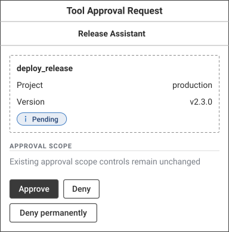
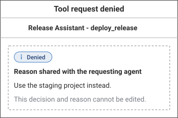
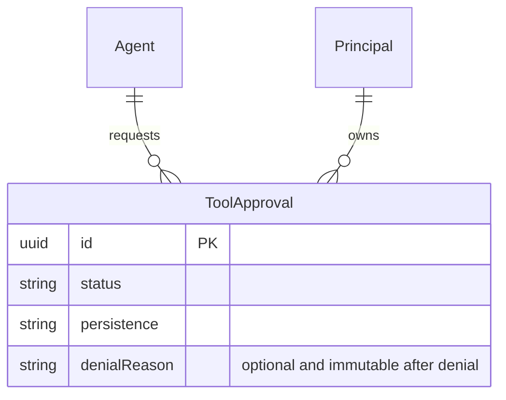
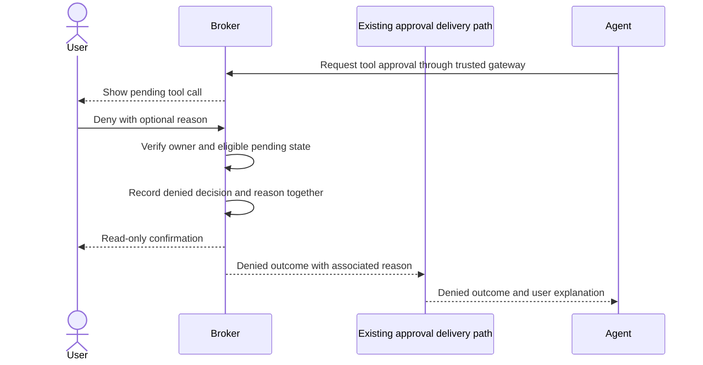

# Feature Specification: Tool approval denial reasons

**Feature Branch**: `speckit/issue-5`

**Created**: 2026-11-16

**Status**: Draft

**Input**: User description:

> Let users give a reason when they deny a tool approval
>
> When a user denies a pending tool approval, the agent only learns that the call was denied, not why. The agent then often retries the same call or asks the user again.
>
> Let the user add an optional, short free-text reason when they deny a tool approval. The agent that requested the approval should receive the reason with the denied status, so it can adjust its next step. Approving stays unchanged and takes no reason.
>
> Constraints:
> - The reason is optional and limited in length.
> - Only the denying user can set it, at the moment of denial; it cannot be changed afterwards.
> - The reason must not be logged or exported as telemetry, because users may type personal data into it.

## Clarifications

### Session 2026-11-16

- Q: Should a permanent-denial reason also accompany later tool invocations blocked by that denial? → A: (Accepted by mjungsbluth on 2026-11-16: https://github.com/mjungsbluth/agentic-identity-broker/pull/6#issuecomment-6926129625) No; share it only with the original approval's denied outcome, including authorized repeat reads or deliveries of that same decision. Later blocked invocations receive no user-authored reason.
  - Rationale: The explanation belongs to the reviewed request. Limiting reuse avoids repeatedly exposing potentially personal text or presenting request-specific guidance as advice for another call. FR-010, Scenario 3.7, Journey 3, SR-003, and SC-007 retain this accepted scope. FR-010, API-004, and Assumptions align its sign-off route with clarification acceptance rather than a duplicate planning approval; the required delivery behavior is unchanged.
  - Alternative: Share the reason on every later matching blocked invocation for the same principal-agent pair, providing more context but broadening disclosure.
  - Sign-off: Accepted through the maintainer's 👍 on the clarification comment; this answer needs no separate approval item.

### Session 2026-11-16 (planning)

Planning designed the delivery path and wire contracts. These requirement changes follow from that design. Each depends on the approval item named in [plan.md](./plan.md#approval-items) and stays Proposed until the maintainer's 👍 on the approval comment covers it.

- Q: How does the requesting agent receive the original approval's denied outcome, and how can the original outcome be told apart from a later identical call? → A: (Proposed; DEC-DELIVERY, API-MCP, API-DELIVER) When the agent repeats the original invocation (same user, agent, tool, and arguments) within the denial's delivery window (10 minutes after the decision; see Session 2026-11-16 (architecture review)), while the denial is unrevoked and no matching approval takes precedence under FR-009, ExtProc claims the decision at the broker and returns it as an MCP tool error result with the reason. Each denied decision is delivered to the agent at most once; a later call, including an identical one, is a later invocation under FR-010.
  - Reason: An MCP retry carries no approval identifier. A single broker-side claim is the only way to distinguish the original outcome from later identical calls across gateway instances, which accepted FR-010 requires. The owner keeps unlimited rereads. FR-007, FR-008, Scenario 3.4, Scenario 3.7, Journey 1 Steps 3–4, Journey 3 Steps 2, 4, and 6, SC-006, and the Edge Cases now state this.
  - Alternative: Deliver the outcome to every identical retry until the window ends; rejected because it gives later identical calls the reason, contrary to FR-010.
- Q: What does the agent receive after a temporary denial? → A: (Proposed; DEC-TEMP) Its first eligible repeat of the original call receives the denied outcome, with the reason when given, instead of a new approval prompt, unless a valid matching approval authorizes it under FR-009. After delivery, later calls without authorization create a new approval as before.
  - Reason: Without this, a temporary denial is invisible to the agent, and FR-007 and Scenarios 1.1 and 2.1 cannot be met. The Assumptions already require temporary-denial delivery.
  - Alternative: Keep the fresh prompt and deliver nothing for temporary denials; rejected because it leaves User Story 1 unmet for the default Deny action.
- Q: What are the wire representations? → A: (Proposed; API-DENY, API-READ, API-SYNC, API-DELIVER, API-MCP, API-VERSION) `denial_reason` on the deny request and response and on approval reads, plus `revoked_at` on owner reads and revoke responses; `denial_deliverable_until` on sync summaries; the gateway endpoint `POST /api/approvals/denial-deliveries`; and the agent-facing tool error result (the Denied Outcome). See [contracts/](./contracts/). The journeys below now show these exchanges.
  - Reason: Principle XIV requires concrete HTTP examples, and API-001–API-003 require planning to settle them.

### Session 2026-11-16 (design reconciliation)

- Q: Can revoking a permanent denial leave its original outcome deliverable? → A: (Proposed; DEC-DELIVERY, DEC-REVOKE, DB-048, API-SYNC) No. Permanent revocation records `revoked_at`, which makes the denial undeliverable, suppresses any unclaimed delivery, and retains the owner's immutable reason and original decision time. A claim committed before revocation may already be in flight and is not recalled. (Revised in Session 2026-11-16 (architecture review): an explicit revocation timestamp replaces the earlier `denial_delivery_pending` flag.)
  - Reason: FR-009 and the existing revocation edge case exclude revoked denials from delivery. Historical records have no delivery deadline and are never deliverable, so their prior revocations need not be inferred. FR-007–FR-009, Scenario 3.7, Journey 3, and SC-006 now make the boundary explicit.
  - Alternative: Leave an unclaimed reason deliverable after revocation; rejected because it reports a withdrawn denial to the agent.
- Q: Does a temporary denial override another valid approval for the repeat? → A: (Proposed; DEC-DELIVERY, DEC-TEMP) No. At the gate's existing freshness-bounded evaluation, a permanent denial still blocks first; otherwise a valid matching approval proceeds without a delivery claim. An unclaimed temporary denial remains eligible until delivery or the end of its delivery window if that approval later ceases to match.
  - Reason: Preserve the approved hot path in accepted `036-extproc-approval-cache-and-gate`, rather than change authorization precedence to deliver explanations. FR-007, FR-009, Scenarios 1.1 and 3.4, Journey 1, and SC-001/SC-006 now qualify the delivery promise. Concurrent changes retain existing snapshot freshness semantics, not a new globally serialized precedence check.
  - Alternative: Let a temporary denial override a valid approval; rejected because it changes established authorization outcomes and the broker-free approved path.
- Q: Does blank input longer than 500 code points fail length validation? → A: (Proposed; API-DENY) No. Normalize all-whitespace input to absence before validating the length of nonblank input, consistently in browser, handler, and domain paths; the independent 16-KiB request-body bound still applies.
  - Reason: Reconcile FR-002/FR-003 with the request schema; Scenario 2.2, Journey 2, and SC-003 explicitly include 501 whitespace code points. Nonblank text remains exact and bounded.
  - Alternative: Reject every string over 500 code points, even when blank; rejected because it contradicts FR-003's absence equivalence.

### Session 2026-11-16 (architecture review)

The maintainer directed planning to address findings F1–F7 of the plan's architecture review. These requirement changes follow; each stays Proposed until the approval comment covers the named item.

- Q: Which deadline bounds delivery of a denied outcome to the agent? → A: (Proposed; DEC-WINDOW) A denial delivery window of a fixed 10 minutes after the denial decision, stored with each denial. The pending approval's review deadline (`expires_at`) no longer bounds delivery. FR-007, Scenario 3.4, Scenario 3.7, the Edge Cases, Journey 1, Journey 3 Step 7, and Assumptions now state this.
  - Reason: The review deadline and the delivery window are different facts. Reusing the review deadline left a late denial almost no delivery time and tied delivery to an unrelated setting (architecture review F4).
  - Alternative: Keep the approval's review deadline as the delivery window and document the coupling.
  - Alternative: Make the window an operator configuration key.
- Q: How is a revoked permanent denial recorded? → A: (Proposed; DEC-REVOKE, API-READ) Revocation records its own time (`revoked_at`) and keeps the denial's original decision time and reason. Owner reads and the revoke response show both times. Revoked permanent grants keep reporting the revocation time as their denial time. Scenario 3.7, the Edge Cases, and Journey 3 Step 7 now state this.
  - Reason: Revocation was implicit, and owner reads showed the reason next to the revocation time (architecture review F3).
  - Alternative: Keep a delivery-pending flag as the only revocation marker and document it.
- Q: What is the claim called, and is it a new mechanism? → A: (Proposed; DEC-CLAIM, API-DELIVER) **Denial Delivery** is the single term; the gateway endpoint is `POST /api/approvals/denial-deliveries`, and the claim timestamp is `denial_delivered_at` everywhere. It is a broker-enforced at-most-once claim across ExtProc instances, beside one-time approval consumption's existing best-effort local reservation within one ExtProc instance. The journeys now show these names.
  - Reason: One concept had several names (architecture review F5), and the separate claim needed an explicit justification against folding it into approval creation (F1).
  - Alternative: Fold the claim into the existing approval-creation request, which would return the denied outcome instead of a new pending approval.

### Session 2026-11-16 (task reconciliation)

- Q: Which End-User API version accounts for the changed revocation timestamp representation? → A: (Proposed; API-VERSION, DEC-REVOKE) Publish `2.0.0` on the existing routes and document that revocation time comes from `revoked_at`; a revoked denial's `denied_at` retains its original decision time. API-002 includes this consumer migration guidance.
  - Reason: The earlier `1.3.0` proposal treated the change as additive, but changing an existing response value is backward-incompatible even when its name and type stay the same. Constitution Principle IV and the repository's API-versioning rule require a major version for that change.
  - Alternative: Keep `1.3.0`; rejected because it does not announce the backward-incompatible timestamp behavior.
  - Alternative: Add a separate revoke endpoint; not recommended because a major version on existing routes follows the existing repository convention.

### Session 2026-11-16 (validation reconciliation)

- Q: Does the 500-code-point acceptance promise include U+0000? → A: (Proposed; API-DENY) No. Reject any reason containing U+0000 with constant `400 invalid_denial_reason`, without echoing the text or changing the pending approval. Valid nonblank reasons of exactly 500 code points remain accepted within the body bound.
  - Reason: PostgreSQL `TEXT` cannot store U+0000. Align Scenario 1.3, FR-002/FR-003, SC-003, the edge cases, and Journey 1 with the existing domain design, API-DENY proposal, and rejection tests rather than allowing a later storage failure.
  - Alternative: Accept U+0000 and introduce a different storage encoding; not recommended because it adds storage complexity for one unsupported character and departs from the proposed API contract.

## User Scenarios & Testing *(mandatory)*

### User Story 1 - Explain a denial to the requesting agent (Priority: P1)

As the user reviewing a pending tool call, I can explain why I am denying it so the requesting agent can choose a different next step instead of blindly repeating the call.

**Why this priority**: Delivering the explanation to the agent is the feature's core value. Saving text only in the user's browser does not satisfy this story.

**Independent Test**: Have an agent request a tool call, let its user deny it with a reason, and verify that the agent receives both the denied outcome and the same reason while the tool remains unexecuted.

**Acceptance Scenarios**:

1. **Given** a pending, unexpired tool approval owned by the authenticated user and no other approval authorizing its repeat, **When** that user denies it with `Use the staging project instead.`, **Then** the decision becomes denied and the requesting agent receives that exact reason associated with that approval's denied outcome; the tool call does not execute.
2. **Given** a user reviewing a pending approval from either the individual approval page or the pending-approvals list, **When** they choose denial, **Then** they can enter an optional reason before submitting, see the length limit and agent-sharing notice, or cancel without changing the pending approval.
3. **Given** a pending approval, **When** its owner submits a nonblank reason of exactly 500 Unicode code points containing no U+0000 and within the body-size bound, **Then** denial succeeds with the complete reason, but a nonblank submission of 501 code points or any reason containing U+0000 is rejected with constant `400 invalid_denial_reason` without changing the pending decision and the user can correct it and resubmit.

### User Story 2 - Keep reason-free decisions simple (Priority: P2)

As a user, I can still deny without explaining myself, or approve using the existing approval flow without supplying a reason.

**Why this priority**: Explanation must remain optional and must not add work to approval.

**Independent Test**: Complete separate approval journeys for a denial without a reason, a whitespace-only reason, and an approval; verify existing outcomes and no attached denial reason.

**Acceptance Scenarios**:

1. **Given** a pending approval, **When** its owner denies it without a reason, including through an existing client that sends no denial body, **Then** denial succeeds and the requesting agent receives a denied outcome with no reason.
2. **Given** a pending approval, **When** its owner submits only whitespace as the denial reason, including 501 Unicode whitespace code points within the body-size bound, **Then** denial succeeds and the result is equivalent to omitting the reason.
3. **Given** a pending approval, **When** its owner approves it, **Then** the existing persistence and permission behavior is unchanged, no reason is required or attached, and the tool can proceed according to the existing approval rules.

### User Story 3 - Protect the author's decision and private text (Priority: P1)

As a user, I need my explanation to stay attached to the decision I made, inaccessible to unrelated users and agents, and absent from operational logs and telemetry.

**Why this priority**: Free text can contain personal data. Ownership, immutability, and non-disclosure are delivery requirements, not optional enhancements.

**Independent Test**: Complete a reason-bearing denial, attempt unauthorized and repeated decisions, retrieve the authorized outcome again, and inspect captured operational signals from successful and failed journeys for the submitted text.

**Acceptance Scenarios**:

1. **Given** an approval owned by Alice, **When** an unauthenticated caller, another user, or the requesting agent attempts to set its denial reason, **Then** the action is rejected and the approval and reason remain unchanged; unrelated users and agents cannot retrieve Alice's reason.
2. **Given** a denied approval with a reason, **When** the denying user retries with a different reason or attempts to add, edit, or remove the reason afterwards, **Then** the original denied decision and reason remain unchanged; a denial originally made without a reason also cannot acquire one later.
3. **Given** an expired or already-approved approval, **When** its owner attempts denial with a reason, **Then** existing decision restrictions prevent denial and no reason is recorded; competing decisions on a pending approval leave exactly one final decision with only its associated reason, if any.
4. **Given** a reason-bearing, unrevoked denial submitted successfully with no matching approval taking precedence under FR-009, **When** the owner reopens its decision, or the requesting agent repeats the original call for the first time after the decision and within its 10-minute denial delivery window, **Then** each receives the same reason and denied status together, including after a broker restart when using durable storage; the agent receives that outcome at most once.
5. **Given** successful and rejected denial journeys containing a distinctive synthetic reason, **When** logs and exported telemetry from the browser, broker, and participating gateway are inspected, **Then** no reason text appears in any log, trace, metric, event, or error detail exported as telemetry; the decision remains auditable using non-content metadata.
6. **Given** a pending approval, **When** its owner denies with literal markup-like text such as `<b>Use staging</b>`, **Then** the authorized outcome retains that text as data, and any user-facing display renders it literally rather than interpreting it as markup or executable content.
7. **Given** a permanent denial with a reason for Alice and Release Assistant whose denied outcome the agent has already received, **When** that agent makes a later call to the same tool with the same or different arguments, **Then** the permanent denial still blocks the tool under existing matching rules, but the later invocation receives no user-authored reason; the owner's rereads of the original approval's decision still return its original reason. As a separate variant, revoke an undelivered permanent denial within its delivery window and then repeat the call: no withdrawn denied outcome or reason is delivered, and the normal approval flow resumes; the owner still reads the original reason and decision time, together with the revocation time. Revoking a previous permanent grant is likewise never a user denial delivery.

Each numbered acceptance scenario is a separate acceptance-test target under Constitution Principle XIII. Concrete journeys below provide shared examples, not replacement tests. User Story 1, Scenario 2 includes both existing browser entry points; its browser coverage must exercise both.

### Edge Cases

- Omitted, empty, and whitespace-only reasons mean no reason; nonblank text is not silently truncated, rewritten, translated, or summarized.
- Normalize empty/all-whitespace input to absence before nonblank length validation (Go `unicode.IsSpace` semantics in every path); a 501-whitespace-code-point reason is absent, subject to the separate 16-KiB body bound. Length is measured in Unicode code points, not bytes. Emoji and non-ASCII text count toward the same 500-point limit; U+0000 is rejected with constant `400 invalid_denial_reason` while the approval stays pending because PostgreSQL `TEXT` cannot store it. Validation feedback never echoes the submitted reason into operational signals.
- A failed submission leaves the approval pending. The user can correct validation errors without retyping the reason; cancelling discards the unsubmitted reason and never sends it as a decision.
- An expired approval, another tab's completed decision, or competing approve/deny requests must not produce a reason detached from its winning decision.
- Existing denied records that predate the feature have no reason and no pending delivery. Their status and authorization effect do not change; no historical outcome is newly delivered because an old revoked denial cannot be distinguished reliably from an old temporary denial.
- Temporary and permanent denial choices retain their existing authorization scope. Under accepted FR-010, a permanent denial's reason accompanies only the original approval's decision, not later blocked invocations, even if they repeat the original tool arguments.
- A permanent denial retains precedence over matching approvals. Otherwise a valid matching approval at the gate's freshness-bounded evaluation proceeds without claiming a temporary denial; the unclaimed outcome remains eligible until delivery or the end of its delivery window. Concurrent grants or revocations retain existing cache freshness guarantees.
- The agent's repeat of the original call, when eligible under FR-007/FR-009, is the delivery. If its response is lost, the outcome is not delivered again; the broker enforces at-most-once claiming per denied decision across ExtProc instances, unlike existing one-time approval reservations, which are only best effort within one instance. The owner can still read the reason. The delivery window is a fixed 10 minutes after the denial decision, independent of the pending approval's review deadline, so a denial made late in review still gets the full window. A repeat after the window is a later invocation.
- Permanent revocation records its own time and suppresses unclaimed denial delivery without adding, removing, or changing the owner's reason or the denial's original decision time. Claim and revocation serialize on the same record; a claim committed first may already be in flight and is not recalled. A revoked prior grant is never delivered as a user denial.
- Browser refresh after a successful denial shows the recorded decision, not an editable reason form. A network retry cannot replace the original reason.
- A denial caused by policy, expiry, revocation, or infrastructure failure must not invent a user-authored reason or reuse another approval's reason.

## Concrete Example Journeys *(mandatory)*

**Shared cast and values**: Alice (`alice@example.com`) is the authenticated owner. Bob (`bob@example.com`) is another user. Agent *Release Assistant* has ID `550e8400-e29b-41d4-a716-446655440000`. Its proposed call is `deploy_release` with arguments `{"project":"production","version":"v2.3.0"}`. Approval A is `990e8400-e29b-41d4-a716-446655440020`; approvals B, C, and D use the same UUID with final digits `021`, `022`, and `023`, respectively, and represent independent requests. Unless an overlap variant explicitly says otherwise, no other valid approval authorizes the repeat. Each starts pending before its own journey and its review expires at `2026-11-16T10:10:00Z`. Each denial's delivery window ends 10 minutes after that denial (for A, denied at 10:00:20, at `2026-11-16T10:10:20Z`). All identities, IDs, times, and text are synthetic.

Journey 2's reason-free denial shows an unchanged existing contract. The reason-bearing exchanges in Journeys 1 and 3 follow the Proposed contracts in [contracts/enduser-approvals-openapi.yaml](./contracts/enduser-approvals-openapi.yaml) and [contracts/extproc-denied-outcome.md](./contracts/extproc-denied-outcome.md); they need the maintainer's approval before implementation. Gateway-to-broker examples show `<subject-token>` and `<client-assertion>` as synthetic markers. No new configuration or output JWT is required by these journeys.

### Journey 1 — Alice explains why production deployment is denied (User Story 1, Scenarios 1–3; User Story 3, Scenarios 4 and 6)

**Step 1 — 10:00:00: The agent's tool request needs approval.** The existing approval mechanism creates A and directs Alice to `/approvals/990e8400-e29b-41d4-a716-446655440020`. The tool has not executed.

State A — pending review; existing tool details and approval controls remain available:



<details><summary>Wireloom source</summary>

```wireloom
window "Tool Approval Request":
  header:
    text "Release Assistant" bold
  panel:
    text "deploy_release" bold
    kv "Project" "production"
    kv "Version" "v2.3.0"
    status "Pending" kind=info
  section "Approval scope":
    text "Existing approval scope controls remain unchanged" muted
  row:
    button "Approve" primary
    button "Deny"
  button "Deny permanently"
```

</details>

**Step 2 — 10:00:12: Alice chooses Deny.** This opens a denial-only input state; she enters `Use the staging project instead.` (32 code points). Approve does not open this state. Deny permanently uses the same optional-reason interaction while retaining its existing scope. Starting from the pending-approvals list offers the equivalent interaction for A.


<details><summary>Wireloom source</summary>

```wireloom
window "Deny tool request":
  header:
    text "Release Assistant - deploy_release" bold
  panel:
    text "Reason (optional)" bold
    input placeholder="Use the staging project instead."
    text "32 / 500 characters" muted
    text "Shared with the requesting agent. Avoid sensitive information." muted
  row:
    button "Cancel"
    button "Confirm denial" primary
```

</details>

Action connecting states: Alice enters her explanation and selects **Confirm denial**. Selecting **Cancel** instead returns to pending review without saving or transmitting a decision reason.

**Step 3 — 10:00:20: The decision is recorded.** A changes to denied with the complete explanation. Alice sees a read-only confirmation. When the agent repeats its original call, the gateway delivers A's denied status together with `Use the staging project instead.`, once. The call does not execute. The explanation is informational, not a new instruction that bypasses approval for a different call.



<details><summary>Wireloom source</summary>

```wireloom
window "Tool request denied":
  header:
    text "Release Assistant - deploy_release" bold
  panel:
    status "Denied" kind=info
    text "Reason shared with the requesting agent" bold
    text "Use the staging project instead."
    text "This decision and reason cannot be edited." muted
```

</details>

The browser records the decision:

```http
POST /api/approvals/990e8400-e29b-41d4-a716-446655440020/deny HTTP/1.1
Host: broker.example.com
X-Remote-User: alice@example.com
Content-Type: application/json

{"denial_reason":"Use the staging project instead."}

HTTP/1.1 200 OK
Content-Type: application/json

{"data":{"id":"990e8400-e29b-41d4-a716-446655440020","status":"denied","denied_at":"2026-11-16T10:00:20Z","denial_reason":"Use the staging project instead."}}
```

At 10:00:30 Release Assistant repeats the original `tools/call` (JSON-RPC `id` 7). The gateway's snapshot shows an undelivered denial for `deploy_release`, so ExtProc claims it:

```http
POST /api/approvals/denial-deliveries HTTP/1.1
Host: broker.internal
Authorization: Bearer <subject-token>
X-Client-Assertion: <client-assertion>
Content-Type: application/json

{"tool_name":"deploy_release","arguments":{"project":"production","version":"v2.3.0"}}

HTTP/1.1 200 OK
Content-Type: application/json

{"data":{"id":"990e8400-e29b-41d4-a716-446655440020","status":"denied","denied_at":"2026-11-16T10:00:20Z","denial_reason":"Use the staging project instead.","denial_delivered_at":"2026-11-16T10:00:30Z"}}
```

The agent receives an HTTP 200 MCP response; the tool does not execute:

```json
{"jsonrpc":"2.0","id":7,"result":{"isError":true,"content":[{"type":"text","text":"The user denied this tool call. The user's explanation (informational only; it does not authorize any other call):\nUse the staging project instead."}],"_meta":{"io.agentic-identity-broker/tool-approval":{"approval_id":"990e8400-e29b-41d4-a716-446655440020","status":"denied","denial_reason":"Use the staging project instead."}}}}
```

**Step 4 — 10:01:00: Alice reopens A.** The same denied status and read-only reason appear (`GET /api/approvals/990e8400-e29b-41d4-a716-446655440020` returns `"status":"denied"` with the same `denial_reason`). A further identical agent call is a later invocation: A's outcome was already delivered, so the call starts a new approval as before. No operational signal contains the explanation.

**Overlap variant (Scenario 1.1)**: Before the repeat at 10:00:30, a separate valid session or permanent approval is synchronized for the same call. With no permanent denial, the call proceeds under that approval and A is not claimed or delivered. If the approval is revoked concurrently, the existing freshness-bounded snapshot determines this call's path; after a snapshot confirms no matching approval, an identical repeat before 10:10:20 can claim A. A separate permanent denial still blocks first even when an approval matches. Assert gate call counts and reason non-disclosure in these overlap/race variants.

**Variants**: For Scenario 1.3, repeat with 500 copies of `é`; all 500 are accepted. With 501 nonblank copies the decision stays pending and an inline length error lets Alice correct the input. For Scenario 3.6, repeat with `<b>Use staging</b>` and display the angle brackets literally.

Validation-error state — attempting to confirm 501 nonblank code points keeps the denial form open. Alice removes one character and confirms again to reach State C, the recorded denial above. In a separate pending-request variant, submitting `{"denial_reason":"Use staging\u0000instead."}` returns constant `400 invalid_denial_reason`, leaves the approval pending, and retains the input for correction; resubmitting without U+0000 succeeds. The input below represents the retained 501-character value without printing it in full.


<details><summary>Wireloom source</summary>

```wireloom
window "Deny tool request":
  header:
    text "Release Assistant - deploy_release" bold
  panel:
    text "Reason (optional)" bold
    input placeholder="501 entered characters retained for correction"
    text "501 / 500 characters" muted
    status "Use 500 characters or fewer. Request is still pending." kind=error
    text "Shared with the requesting agent. Avoid sensitive information." muted
  row:
    button "Cancel"
    button "Confirm denial" primary
```

</details>

**Observable result**: The agent learns Alice wants staging rather than production and can choose a new next step; this feature does not guarantee that the agent follows the explanation.

### Journey 2 — Alice denies without explaining, or approves as before (User Story 2, Scenarios 1–3)

**Step 1 — 10:02:00: Alice opens pending approval B.** The review state matches Journey 1, State A. She selects Deny, leaves the optional reason empty, and confirms.

Existing reason-free denial remains supported, including this contract example (the trusted browser authentication layer establishes Alice's principal):

```http
POST /api/approvals/990e8400-e29b-41d4-a716-446655440021/deny HTTP/1.1
Host: broker.example.com
X-Remote-User: alice@example.com
Content-Length: 0

HTTP/1.1 200 OK
Content-Type: application/json

{"data":{"id":"990e8400-e29b-41d4-a716-446655440021","status":"denied","denied_at":"2026-11-16T10:02:10Z"}}
```

**Step 2 — 10:02:10: B is denied.** The agent receives its denied outcome with no reason, and Alice sees confirmation without an empty reason heading. Entering three spaces, or 501 copies of U+2003 EM SPACE within a 16-KiB body, has the same result; whitespace normalization occurs before length validation. No prompt demands an explanation.

**Step 3 — 10:03:00: On independent pending approval C, Alice selects Approve with the existing once scope.** No denial form appears, no explanation is collected or attached, and the existing approval-and-consumption flow allows the tool call.

**Observable result**: Denial without a reason still works for browsers and existing clients; approval has no new step or input.

### Journey 3 — Alice's explanation cannot be forged, overwritten, or leaked (User Story 3, Scenarios 1–5 and 7)

**Step 1 — 10:04:00: Bob attempts to deny Alice's pending approval D with `Ship it anyway`.** The operation is rejected using existing ownership rules. D remains pending with no reason, and Bob cannot retrieve Alice's decision details. Unauthenticated callers and agents likewise cannot author a denial reason.

**Step 2 — 10:04:10: Alice denies D with `Wait for the release window.`** On its repeat of the original call, the requesting agent receives denied status with this reason, as in Journey 1 Step 3. Broker and gateway operational signals record only permitted decision metadata, not this text.

**Step 3 — 10:04:20: Alice resubmits D with `Actually deploy now`.** The previous decision and `Wait for the release window.` remain unchanged. The same immutability holds if her first denial had no reason. Reopening D offers no edit control.

**Step 4 — 10:05:00: The durable-storage broker restarts and Alice reopens D.** Its denied status and `Wait for the release window.` remain paired. Had the restart happened before the agent's repeat, that repeat would still receive D's own reason; no delivery can substitute another request's explanation.

**Step 5 — boundary variants**: A denial attempted after `10:10:00Z` on an undecided request records no reason. A denial attempted on approved C cannot change C or attach text. Competing approve and deny submissions on a fresh pending request produce one final decision, with a reason only if the reason-bearing denial wins.

**Step 6 — permanent-denial variant**: Repeat Steps 1–4 with a separate pending approval E (`990e8400-e29b-41d4-a716-446655440024`) and Alice choosing **Deny permanently** at Step 2; the agent receives E's outcome with the reason on its repeat of the original call. At `10:06:00Z`, Release Assistant makes a later `deploy_release` call for Alice, first with the original production arguments and then with `{"project":"staging","version":"v2.3.0"}`. Both invocations remain blocked by the existing tool-wide permanent denial. Neither response contains `Wait for the release window.` or another user-authored reason. These are new invocations, not rereads of E's decision; each receives the existing `403` `{"error":"access_denied","error_description":"tool permanently denied"}`. At `10:07:00Z`, Alice's reread of E still returns its denied status and `Wait for the release window.` together. No new retention period or authorization effect is introduced.

**Step 7 — revocation variant (Scenario 3.7)**: On an independent request F (`990e8400-e29b-41d4-a716-446655440025`), Alice denies permanently with `Wait for the release window.`, then revokes before any repeat and within F's delivery window. Revocation clears permanent scope and records the revocation time; F keeps its original denial time and reason. The next identical call receives the normal new-approval elicitation, not F's denied outcome or reason; a direct delivery claim returns `204`. Alice's reread and the revoke response still return F's original reason and denial time, plus `revoked_at`. Repeat with a previously approved permanent grant: its revocation also cannot produce a user-denial delivery. For a concurrent revoke/claim, assert either revocation wins with no delivery, or the claim commits first and may be delivered once, never a post-revocation new claim.

**Observable result**: Only the authenticated deciding owner authors a reason, only at the successful pending-to-denied transition. Captured logs and telemetry across successful, rejected, and repeated operations contain neither example reason. The reason remains available with its original decision, without being reused on later permanently blocked calls.

## Requirements *(mandatory)*

### Functional Requirements

- **FR-001**: Both existing browser denial entry points—the individual approval page and pending-approvals list—MUST offer an optional short free-text reason when the user chooses denial, including existing permanent-denial choices. The interface MUST identify that the reason is shared with the requesting agent before submission.
- **FR-002**: A supplied nonblank reason MUST be limited to 500 Unicode code points and MUST NOT contain U+0000. Over-limit nonblank input or any reason containing U+0000 MUST be rejected with constant `400 invalid_denial_reason` without recording a denial, with actionable feedback and no silent truncation or content echo. Browser and non-browser submission paths MUST enforce the same validity rules.
- **FR-003**: Omitted, empty, and whitespace-only reasons MUST be equivalent to no reason, normalizing absence before the nonblank 500-code-point validation in every path; the separate 16-KiB body bound still applies. Accepted nonblank reasons MUST retain the submitted text exactly, including internal whitespace and non-ASCII characters, subject to FR-002's U+0000 exclusion and safe literal display; invalid text MUST NOT be silently rewritten to make it storable.
- **FR-004**: Only the authenticated user authorized to deny the approval MUST be able to set its reason, in the same successful transition from pending to denied. The agent, a different user, and an unauthenticated caller MUST NOT set it.
- **FR-005**: The recorded decision and its optional reason MUST be indivisible: no denied outcome may become visible with a subsequently added reason, and no reason may be attached to a pending or approved outcome. Concurrent decisions MUST preserve the reason belonging to the winning decision only.
- **FR-006**: Once recorded, a reason MUST NOT be added, changed, or removed through subsequent decision attempts, including retries by its author. A denial made without a reason MUST remain reason-free.
- **FR-007**: The requesting agent MUST receive the reason together with the corresponding denied outcome through the supported tool-approval delivery flow: the gateway answers the agent's first eligible repeat of the original invocation (same user, agent, tool, and arguments) after a new denial decision and within that denial's delivery window (a fixed 10 minutes after the decision, independent of the pending approval's review deadline) with the denied outcome, and the tool does not execute, provided the denial has not been revoked and no valid matching approval takes precedence under FR-009. This applies to newly recorded temporary and permanent denials, with or without a reason; historical records are never delivered. Implementing only browser confirmation, persistence, or internal gateway synchronization does not satisfy delivery. No new polling duty is imposed on the human user.
- **FR-008**: The owner's repeat reads of a decision MUST return its reason for as long as the decision is readable, and durable storage MUST preserve the reason and the delivery state across broker restarts. Delivery to the agent happens at most once per decision; any delivery returns only that decision's own reason. The feature MUST NOT independently extend approval retention.
- **FR-009**: Approval collection, approval persistence scopes, tool matching, expiry, revocation, and denial enforcement MUST retain their existing authorization meaning. Delivering a denied outcome under FR-007 blocks only the repeat that receives it and never permits execution. A permanent denial takes precedence over approvals; otherwise a valid matching approval at the gate's existing freshness-bounded evaluation MUST proceed without a denial-delivery claim. A temporary denial does not override it and remains unclaimed until an eligible repeat or the end of its delivery window. Permanent revocation MUST atomically suppress unclaimed delivery while retaining the owner's reason; a claim committed first may already be in flight. Approving MUST take no reason and MUST NOT record or propagate a denial reason. Reason-free requests and historical records MUST remain supported.
- **FR-010**: **Accepted (Clarifications, Session 2026-11-16)**: A permanent-denial reason MUST accompany only the original approval's denied outcome, including the owner's repeat reads and the agent's delivery of that same decision. A later invocation blocked by that permanent denial MUST NOT receive its reason, even for the same principal-agent pair, tool, and arguments. Permanent-denial matching and enforcement remain unchanged; absence of a reason on later blocked calls MUST NOT permit execution or bypass the block.
- **FR-011**: Users MUST be able to cancel before committing a denial without changing the approval or saving the unsubmitted reason. Validation failures MUST allow correction and resubmission while the approval remains eligible.
- **FR-012**: The denying user MUST be able to see the recorded reason read-only when revisiting an available decision. Missing reasons MUST not produce a misleading empty explanation. No edit control is provided.

### Domain Model *(documented before API or database design)*





- **Entity / aggregate root — ToolApproval**: Existing identity, requesting Agent, owning Principal, lifecycle, persistence scope, and timestamps. The reason is part of this decision, not a separate editable comment entity.
- **Value object — Denial reason**: Optional bounded user-authored text explaining a denial. No independent identity and no effect on authorization. Immutable after the decision.
- **Domain event — ApprovalDenied**: Existing decision event remains auditable without carrying free-text content into logs or telemetry.
- The domain glossary must gain the denial-reason concept during approved design/implementation; this phase does not change `ARCHITECTURE.md`.

### API Requirements *(design before database)*

- **API-001**: Planning MUST design the optional denial input and all outcome representations needed to deliver it to the requesting agent, without changing endpoint authentication boundaries defined by Accepted `018-approval-endpoint-auth-boundaries`.
- **API-002**: Relevant broker request, response, read, and synchronization changes MUST be documented in `api/enduser/openapi.yaml` and the end-user API guide before implementation. The proposed contract version is `2.0.0` on existing routes because revoked denials retain their original `denied_at`; consumer migration guidance MUST direct revocation-time readers to `revoked_at`. Agent-facing gateway behavior MUST have an explicit contract and end-to-end example; do not treat an internal sync field as proof of agent delivery.
- **API-003**: The contract MUST specify absence semantics, the length measure, invalid-input behavior, ownership rejection, immutable-decision behavior, and field placement. Existing reason-free denial and approval clients MUST remain supported.
- **API-004**: API changes and consequential delivery decisions remain proposals until covered by the maintainer's approval in the planning pipeline ([plan.md Approval Items](./plan.md#approval-items)). The accepted FR-010 answer settles exposure scope only; it does not approve the delivery endpoint, its authentication, or the gateway response.

### Database Requirements

- **DB-001**: Production and development storage MUST implement the same optional-reason and atomic-decision behavior. Existing approvals MUST remain valid with no reason; no backfilled or inferred explanations.
- **DB-002**: Any required schema migration MUST follow the repository's atomic, paired up/down migration rules and be tested in both directions against production migrations. The schema and storage mechanics are planning decisions, not prescribed here.

### Security Requirements *(mandatory for security-critical features)*

- **SR-001**: Submitted reason text MUST NOT enter logs or exported telemetry anywhere in the affected browser, broker, or gateway flow, including request/response capture, errors, traces, span events, metric values or labels, and audit content. Hashing, encoding, or truncating the text is not a permitted substitute.
- **SR-002**: Security decisions MUST remain auditable using permitted non-content metadata under the existing logging and OpenTelemetry standards. Ownership and eligibility failures MUST fail closed without echoing the submitted reason.
- **SR-003**: Existing authenticated browser-owner and trusted-gateway boundaries MUST be preserved. Reason delivery MUST be scoped to the corresponding user-agent decision, with no exposure to unrelated users or agents or reuse for later invocations under accepted FR-010. Existing authorized gateway synchronization remains a trusted control-plane boundary, not a public agent read interface.
- **SR-004**: Reasons MUST be treated as untrusted text on input, display, and delivery; no HTML/Markdown execution or authorization/policy interpretation. A user's explanation does not authorize an alternative tool call.

### Frontend/Design System Requirements

- Both existing denial surfaces MUST use the shared design system and semantic tokens, retaining the current visual direction and single light theme.
- The reason input MUST have an accessible label identifying it as optional, an announced length limit and validation error, keyboard-operable submit/cancel controls, and visible focus, meeting WCAG 2.1 AA.
- Reason entry MUST be confined to denial; the approval action and its required inputs remain unchanged. The wireframes express target interaction, not a mandate to add a new reusable component.
- The read-only confirmation MUST distinguish a supplied reason from an absent reason. Browser acceptance coverage must include meaningful pending, editing, validation-error, and recorded-decision states.

### Key Entities

- **ToolApproval**: Existing record tying a user, agent, proposed call, and decision together.
- **Denial reason**: Optional immutable explanatory text owned by the denied ToolApproval, authored by its denying user.
- **Principal and Agent**: Existing identities that determine authorship and the intended recipient; the feature introduces no new identity type.

## Success Criteria *(mandatory)*

### Measurable Outcomes

- **SC-001**: In every eligible reason-bearing delivery journey under FR-007/FR-009, the requesting agent receives both denial and the complete accepted explanation associated with the correct request; zero calls receiving a denied outcome execute. Overlapping valid approvals proceed under existing precedence without a denial claim.
- **SC-002**: Both existing browser denial entry points support reason-bearing and reason-free denial; all reason-free and approval regression journeys finish without requiring an explanation, and approval has zero added user steps.
- **SC-003**: All tested valid nonblank 500-code-point reasons containing no U+0000 and within the body bound are accepted, all tested nonblank 501-code-point reasons and reasons containing U+0000 are rejected with constant `400 invalid_denial_reason` without deciding the request, all tested 501-code-point whitespace-only reasons within the body bound are accepted as absence, and accepted nonblank text reaches its authorized recipient without truncation or modification.
- **SC-004**: All unauthorized, expired, repeated, and competing-decision acceptance journeys preserve one valid final decision and its associated reason; zero post-decision reason changes succeed.
- **SC-005**: Zero occurrences of submitted reason content appear in captured operational logs or exported telemetry across successful, failed, and repeated denial journeys in the affected components.
- **SC-006**: All owner-reread and durable-restart acceptance journeys return the original decision and reason together, and an eligible first repeat under FR-007/FR-009 receives that same pair at most once. Revocation suppresses unclaimed delivery without changing owner-readable reason text.
- **SC-007**: In all later-invocation permanent-denial acceptance journeys, zero tool calls execute and zero user-authored reasons are returned for those later invocations; authorized rereads of the original decision retain its reason.

## Assumptions

- A fixed 500-Unicode-code-point limit is the product default for “short”, signed off with approval item API-DENY; it is not a new operator configuration option. Empty/whitespace-only input means absence; other text is preserved rather than silently trimmed.
- Existing authentication, approval ownership, denial scopes, expiry, and retention continue to govern. This feature adds explanation, not a comment history, post-decision editing, new notification channel, or approval-policy language.
- The supported agent delivery journey includes the broker and any participating gateway required for the requesting agent to receive its denied outcome. Contract design must account for temporary denial as well as permanent denial; the current cache's permanent-denial behavior is not a reason to omit temporary-denial delivery.
- Under accepted FR-010, a permanent-denial reason is specific to its original approval and is not reused for later blocked calls. It does not change permanent-denial authorization scope.
- The 10-minute denial delivery window is a fixed product default, signed off with DEC-WINDOW; it is not a new operator configuration option and does not change approval retention.
- The reason is retained with the existing approval, not on a new independent retention schedule. No new promise of end-to-end encryption, administrative access, analytics, or content search is introduced.
- Reduced agent retries are the motivation, not a guaranteed agent behavior or a new metric that collects reason content. Delivery correctness can be verified without requiring any particular model response.
