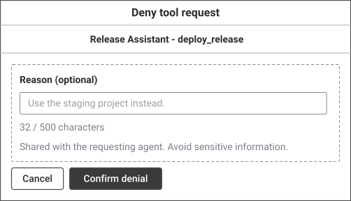
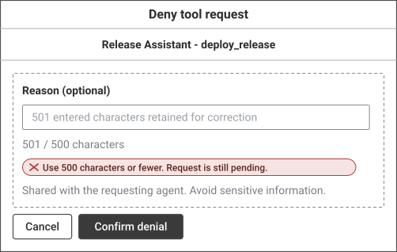
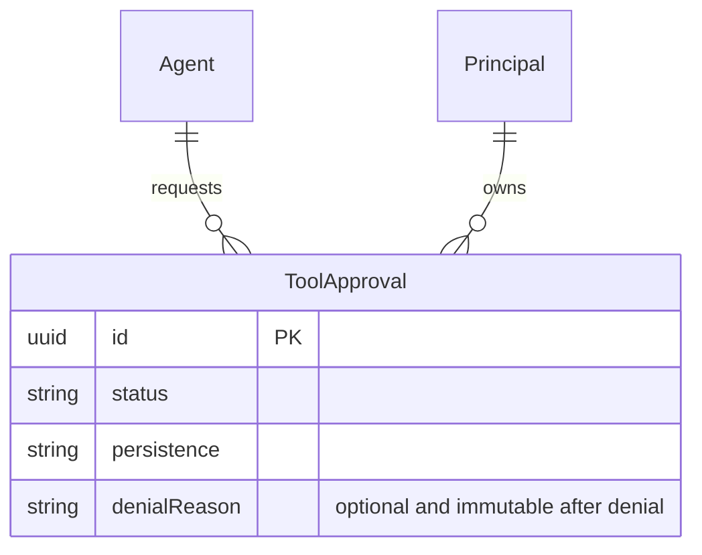
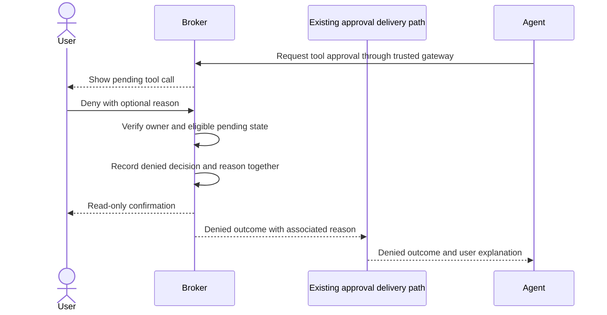

# Feature Specification: Tool approval denial reasons

**Feature Branch**: `speckit/issue-5`

**Created**: 2026-11-16

**Status**: Draft

**Input**: User description:

> Let users give a reason when they deny a tool approval
>
> When a user denies a pending tool approval, the agent only learns that the call was denied, not why. The agent then often retries the same call or asks the user again.
>
> Let the user add an optional, short free-text reason when they deny a tool approval. The agent that requested the approval should receive the reason with the denied status, so it can adjust its next step. Approving stays unchanged and takes no reason.
>
> Constraints:
> - The reason is optional and limited in length.
> - Only the denying user can set it, at the moment of denial; it cannot be changed afterwards.
> - The reason must not be logged or exported as telemetry, because users may type personal data into it.

## Clarifications

### Session 2026-11-16

- Q: Should a permanent-denial reason also accompany later tool invocations blocked by that denial? → A: (Proposed) No; share it only with the original approval's denied outcome, including authorized repeat reads or deliveries of that same decision. Later blocked invocations receive no user-authored reason.
  - Rationale: The explanation belongs to the reviewed request. Limiting reuse avoids repeatedly exposing potentially personal text or presenting request-specific guidance as advice for another call. FR-010, Scenario 3.7, Journey 3, SR-003, and SC-007 retain this proposed scope. FR-010, API-004, and Assumptions align its sign-off route with clarification acceptance rather than a duplicate planning approval; the required delivery behavior is unchanged.
  - Alternative: Share the reason on every later matching blocked invocation for the same principal-agent pair, providing more context but broadening disclosure.
  - Sign-off: A maintainer's 👍 on the clarification comment accepts this answer; planning records that acceptance. This answer needs no separate approval item. No acceptance has been recorded.

## User Scenarios & Testing *(mandatory)*

### User Story 1 - Explain a denial to the requesting agent (Priority: P1)

As the user reviewing a pending tool call, I can explain why I am denying it so the requesting agent can choose a different next step instead of blindly repeating the call.

**Why this priority**: Delivering the explanation to the agent is the feature's core value. Saving text only in the user's browser does not satisfy this story.

**Independent Test**: Have an agent request a tool call, let its user deny it with a reason, and verify that the agent receives both the denied outcome and the same reason while the tool remains unexecuted.

**Acceptance Scenarios**:

1. **Given** a pending, unexpired tool approval owned by the authenticated user, **When** that user denies it with `Use the staging project instead.`, **Then** the decision becomes denied and the requesting agent receives that exact reason associated with that approval's denied outcome; the tool call does not execute.
2. **Given** a user reviewing a pending approval from either the individual approval page or the pending-approvals list, **When** they choose denial, **Then** they can enter an optional reason before submitting, see the length limit and agent-sharing notice, or cancel without changing the pending approval.
3. **Given** a pending approval, **When** its owner submits a reason of exactly 500 Unicode code points, **Then** denial succeeds with the complete reason, but a submission of 501 code points is rejected without changing the pending decision and the user can correct it and resubmit.

### User Story 2 - Keep reason-free decisions simple (Priority: P2)

As a user, I can still deny without explaining myself, or approve using the existing approval flow without supplying a reason.

**Why this priority**: Explanation must remain optional and must not add work to approval.

**Independent Test**: Complete separate approval journeys for a denial without a reason, a whitespace-only reason, and an approval; verify existing outcomes and no attached denial reason.

**Acceptance Scenarios**:

1. **Given** a pending approval, **When** its owner denies it without a reason, including through an existing client that sends no denial body, **Then** denial succeeds and the requesting agent receives a denied outcome with no reason.
2. **Given** a pending approval, **When** its owner submits only whitespace as the denial reason, **Then** denial succeeds and the result is equivalent to omitting the reason.
3. **Given** a pending approval, **When** its owner approves it, **Then** the existing persistence and permission behavior is unchanged, no reason is required or attached, and the tool can proceed according to the existing approval rules.

### User Story 3 - Protect the author's decision and private text (Priority: P1)

As a user, I need my explanation to stay attached to the decision I made, inaccessible to unrelated users and agents, and absent from operational logs and telemetry.

**Why this priority**: Free text can contain personal data. Ownership, immutability, and non-disclosure are delivery requirements, not optional enhancements.

**Independent Test**: Complete a reason-bearing denial, attempt unauthorized and repeated decisions, retrieve the authorized outcome again, and inspect captured operational signals from successful and failed journeys for the submitted text.

**Acceptance Scenarios**:

1. **Given** an approval owned by Alice, **When** an unauthenticated caller, another user, or the requesting agent attempts to set its denial reason, **Then** the action is rejected and the approval and reason remain unchanged; unrelated users and agents cannot retrieve Alice's reason.
2. **Given** a denied approval with a reason, **When** the denying user retries with a different reason or attempts to add, edit, or remove the reason afterwards, **Then** the original denied decision and reason remain unchanged; a denial originally made without a reason also cannot acquire one later.
3. **Given** an expired or already-approved approval, **When** its owner attempts denial with a reason, **Then** existing decision restrictions prevent denial and no reason is recorded; competing decisions on a pending approval leave exactly one final decision with only its associated reason, if any.
4. **Given** a reason-bearing denial submitted successfully, **When** the owner reopens its decision or the authorized requesting agent receives that decision again during its existing availability period, **Then** they receive the same reason and denied status together, including after a broker restart when using durable storage.
5. **Given** successful and rejected denial journeys containing a distinctive synthetic reason, **When** logs and exported telemetry from the browser, broker, and participating gateway are inspected, **Then** no reason text appears in any log, trace, metric, event, or error detail exported as telemetry; the decision remains auditable using non-content metadata.
6. **Given** a pending approval, **When** its owner denies with literal markup-like text such as `<b>Use staging</b>`, **Then** the authorized outcome retains that text as data, and any user-facing display renders it literally rather than interpreting it as markup or executable content.
7. **Given** a permanent denial with a reason for Alice and Release Assistant, **When** that agent makes a later call to the same tool with the same or different arguments, **Then** the permanent denial still blocks the tool under existing matching rules, but the later invocation receives no user-authored reason; authorized rereads or deliveries of the original approval's decision still return its original reason during its existing availability period.

Each numbered acceptance scenario is a separate acceptance-test target under Constitution Principle XIII. Concrete journeys below provide shared examples, not replacement tests. User Story 1, Scenario 2 includes both existing browser entry points; its browser coverage must exercise both.

### Edge Cases

- Omitted, empty, and whitespace-only reasons mean no reason; nonblank text is not silently truncated, rewritten, translated, or summarized.
- Length is measured in Unicode code points, not bytes. Emoji and non-ASCII text count toward the same 500-point limit; validation feedback never echoes the submitted reason into operational signals.
- A failed submission leaves the approval pending. The user can correct validation errors without retyping the reason; cancelling discards the unsubmitted reason and never sends it as a decision.
- An expired approval, another tab's completed decision, or competing approve/deny requests must not produce a reason detached from its winning decision.
- Existing denied records that predate the feature have no reason. Their status and authorization effect do not change.
- Temporary and permanent denial choices retain their existing authorization scope. Under the proposed FR-010 scope, a permanent denial's reason accompanies only the original approval's decision, not later blocked invocations, even if they repeat the original tool arguments.
- Browser refresh after a successful denial shows the recorded decision, not an editable reason form. A network retry cannot replace the original reason.
- A denial caused by policy, expiry, revocation, or infrastructure failure must not invent a user-authored reason or reuse another approval's reason.

## Concrete Example Journeys *(mandatory)*

**Shared cast and values**: Alice (`alice@example.com`) is the authenticated owner. Bob (`bob@example.com`) is another user. Agent *Release Assistant* has ID `550e8400-e29b-41d4-a716-446655440000`. Its proposed call is `deploy_release` with arguments `{"project":"production","version":"v2.3.0"}`. Approval A is `990e8400-e29b-41d4-a716-446655440020`; approvals B, C, and D use the same UUID with final digits `021`, `022`, and `023`, respectively, and represent independent requests. Each starts pending before its own journey and expires at `2026-11-16T10:10:00Z`. All identities, IDs, times, and text are synthetic.

The HTTP example below illustrates an unchanged existing contract. Reason-bearing input and agent-facing output are described as target behavior, not as an already-approved wire contract. Their exact HTTP and gateway representations must be designed in planning, documented in the relevant contracts, and approved before implementation. No new configuration or output JWT is required by these journeys.

### Journey 1 — Alice explains why production deployment is denied (User Story 1, Scenarios 1–3; User Story 3, Scenarios 4 and 6)

**Step 1 — 10:00:00: The agent's tool request needs approval.** The existing approval mechanism creates A and directs Alice to `/approvals/990e8400-e29b-41d4-a716-446655440020`. The tool has not executed.

State A — pending review; existing tool details and approval controls remain available:


<details><summary>Wireloom source</summary>

```wireloom
window "Tool Approval Request":
  header:
    text "Release Assistant" bold
  panel:
    text "deploy_release" bold
    kv "Project" "production"
    kv "Version" "v2.3.0"
    status "Pending" kind=info
  section "Approval scope":
    text "Existing approval scope controls remain unchanged" muted
  row:
    button "Approve" primary
    button "Deny"
  button "Deny permanently"
```

</details>

**Step 2 — 10:00:12: Alice chooses Deny.** This opens a denial-only input state; she enters `Use the staging project instead.` (32 code points). Approve does not open this state. Deny permanently uses the same optional-reason interaction while retaining its existing scope. Starting from the pending-approvals list offers the equivalent interaction for A.



<details><summary>Wireloom source</summary>

```wireloom
window "Deny tool request":
  header:
    text "Release Assistant - deploy_release" bold
  panel:
    text "Reason (optional)" bold
    input placeholder="Use the staging project instead."
    text "32 / 500 characters" muted
    text "Shared with the requesting agent. Avoid sensitive information." muted
  row:
    button "Cancel"
    button "Confirm denial" primary
```

</details>

Action connecting states: Alice enters her explanation and selects **Confirm denial**. Selecting **Cancel** instead returns to pending review without saving or transmitting a decision reason.

**Step 3 — 10:00:20: The decision is recorded.** A changes to denied with the complete explanation. Alice sees a read-only confirmation. The requesting agent's existing denial-result path delivers denied status together with `Use the staging project instead.` for A. The call does not execute. The explanation is informational, not a new instruction that bypasses approval for a different call.


<details><summary>Wireloom source</summary>

```wireloom
window "Tool request denied":
  header:
    text "Release Assistant - deploy_release" bold
  panel:
    status "Denied" kind=info
    text "Reason shared with the requesting agent" bold
    text "Use the staging project instead."
    text "This decision and reason cannot be edited." muted
```

</details>

**Step 4 — 10:01:00: Alice reopens A.** The same denied status and read-only reason appear. An authorized reread by the delivery path returns the same pair; no operational signal contains the explanation.

**Variants**: For Scenario 1.3, repeat with 500 copies of `é`; all 500 are accepted. With 501 copies the decision stays pending and an inline length error lets Alice correct the input. For Scenario 3.6, repeat with `<b>Use staging</b>` and display the angle brackets literally.

Validation-error state — attempting to confirm 501 code points keeps the denial form open. Alice removes one character and confirms again to reach State C, the recorded denial above. The input below represents the retained 501-character value without printing it in full.



<details><summary>Wireloom source</summary>

```wireloom
window "Deny tool request":
  header:
    text "Release Assistant - deploy_release" bold
  panel:
    text "Reason (optional)" bold
    input placeholder="501 entered characters retained for correction"
    text "501 / 500 characters" muted
    status "Use 500 characters or fewer. Request is still pending." kind=error
    text "Shared with the requesting agent. Avoid sensitive information." muted
  row:
    button "Cancel"
    button "Confirm denial" primary
```

</details>

**Observable result**: The agent learns Alice wants staging rather than production and can choose a new next step; this feature does not guarantee that the agent follows the explanation.

### Journey 2 — Alice denies without explaining, or approves as before (User Story 2, Scenarios 1–3)

**Step 1 — 10:02:00: Alice opens pending approval B.** The review state matches Journey 1, State A. She selects Deny, leaves the optional reason empty, and confirms.

Existing reason-free denial remains supported, including this contract example (the trusted browser authentication layer establishes Alice's principal):

```http
POST /api/approvals/990e8400-e29b-41d4-a716-446655440021/deny HTTP/1.1
Host: broker.example.com
X-Remote-User: alice@example.com
Content-Length: 0

HTTP/1.1 200 OK
Content-Type: application/json

{"data":{"id":"990e8400-e29b-41d4-a716-446655440021","status":"denied","denied_at":"2026-11-16T10:02:10Z"}}
```

**Step 2 — 10:02:10: B is denied.** The agent receives its denied outcome with no reason, and Alice sees confirmation without an empty reason heading. Entering three spaces has the same result. No prompt demands an explanation.

**Step 3 — 10:03:00: On independent pending approval C, Alice selects Approve with the existing once scope.** No denial form appears, no explanation is collected or attached, and the existing approval-and-consumption flow allows the tool call.

**Observable result**: Denial without a reason still works for browsers and existing clients; approval has no new step or input.

### Journey 3 — Alice's explanation cannot be forged, overwritten, or leaked (User Story 3, Scenarios 1–5 and 7)

**Step 1 — 10:04:00: Bob attempts to deny Alice's pending approval D with `Ship it anyway`.** The operation is rejected using existing ownership rules. D remains pending with no reason, and Bob cannot retrieve Alice's decision details. Unauthenticated callers and agents likewise cannot author a denial reason.

**Step 2 — 10:04:10: Alice denies D with `Wait for the release window.`** The requesting agent receives denied status with this reason. Broker and gateway operational signals record only permitted decision metadata, not this text.

**Step 3 — 10:04:20: Alice resubmits D with `Actually deploy now`.** The previous decision and `Wait for the release window.` remain unchanged. The same immutability holds if her first denial had no reason. Reopening D offers no edit control.

**Step 4 — 10:05:00: The durable-storage broker restarts and Alice reopens D.** Its denied status and `Wait for the release window.` remain paired. An authorized repeat delivery cannot substitute another request's explanation.

**Step 5 — boundary variants**: A denial attempted after `10:10:00Z` on an undecided request records no reason. A denial attempted on approved C cannot change C or attach text. Competing approve and deny submissions on a fresh pending request produce one final decision, with a reason only if the reason-bearing denial wins.

**Step 6 — permanent-denial variant**: Repeat Steps 1–4 with a separate pending approval E (`990e8400-e29b-41d4-a716-446655440024`) and Alice choosing **Deny permanently** at Step 2. At `10:06:00Z`, Release Assistant makes a later `deploy_release` call for Alice, first with the original production arguments and then with `{"project":"staging","version":"v2.3.0"}`. Both invocations remain blocked by the existing tool-wide permanent denial. Neither response contains `Wait for the release window.` or another user-authored reason. These are new invocations, not rereads of E's decision. At `10:07:00Z`, an authorized reread of E still returns its denied status and `Wait for the release window.` together. No new retention period or authorization effect is introduced.

**Observable result**: Only the authenticated deciding owner authors a reason, only at the successful pending-to-denied transition. Captured logs and telemetry across successful, rejected, and repeated operations contain neither example reason. The reason remains available with its original decision, without being reused on later permanently blocked calls.

## Requirements *(mandatory)*

### Functional Requirements

- **FR-001**: Both existing browser denial entry points—the individual approval page and pending-approvals list—MUST offer an optional short free-text reason when the user chooses denial, including existing permanent-denial choices. The interface MUST identify that the reason is shared with the requesting agent before submission.
- **FR-002**: A supplied nonblank reason MUST be limited to 500 Unicode code points. Over-limit input MUST be rejected without recording a denial, with actionable feedback and no silent truncation. Browser and non-browser submission paths MUST enforce the same limit.
- **FR-003**: Omitted, empty, and whitespace-only reasons MUST be equivalent to no reason. Nonblank reasons MUST retain the submitted text exactly, including internal whitespace and non-ASCII characters, subject to safe literal display.
- **FR-004**: Only the authenticated user authorized to deny the approval MUST be able to set its reason, in the same successful transition from pending to denied. The agent, a different user, and an unauthenticated caller MUST NOT set it.
- **FR-005**: The recorded decision and its optional reason MUST be indivisible: no denied outcome may become visible with a subsequently added reason, and no reason may be attached to a pending or approved outcome. Concurrent decisions MUST preserve the reason belonging to the winning decision only.
- **FR-006**: Once recorded, a reason MUST NOT be added, changed, or removed through subsequent decision attempts, including retries by its author. A denial made without a reason MUST remain reason-free.
- **FR-007**: The requesting agent MUST receive the reason together with the corresponding denied outcome through the supported tool-approval delivery flow. Implementing only browser confirmation, persistence, or internal gateway synchronization does not satisfy delivery. No new polling duty is imposed on the human user.
- **FR-008**: Authorized repeat reads or deliveries of the same decision MUST preserve its reason throughout that decision's existing availability period; durable storage MUST preserve it across broker restarts. The feature MUST NOT independently extend approval retention.
- **FR-009**: Approval collection, approval persistence scopes, tool matching, expiry, revocation, and denial enforcement MUST retain their existing authorization meaning. Approving MUST take no reason and MUST NOT record or propagate a denial reason. Reason-free requests and historical records MUST remain supported.
- **FR-010**: **Proposed (Clarifications, Session 2026-11-16)**: A permanent-denial reason MUST accompany only the original approval's denied outcome, including authorized repeat reads or deliveries of that same decision. A later invocation blocked by that permanent denial MUST NOT receive its reason, even for the same principal-agent pair, tool, and arguments. Permanent-denial matching and enforcement remain unchanged; absence of a reason on later blocked calls MUST NOT permit execution or bypass the block.
- **FR-011**: Users MUST be able to cancel before committing a denial without changing the approval or saving the unsubmitted reason. Validation failures MUST allow correction and resubmission while the approval remains eligible.
- **FR-012**: The denying user MUST be able to see the recorded reason read-only when revisiting an available decision. Missing reasons MUST not produce a misleading empty explanation. No edit control is provided.

### Domain Model *(documented before API or database design)*





- **Entity / aggregate root — ToolApproval**: Existing identity, requesting Agent, owning Principal, lifecycle, persistence scope, and timestamps. The reason is part of this decision, not a separate editable comment entity.
- **Value object — Denial reason**: Optional bounded user-authored text explaining a denial. No independent identity and no effect on authorization. Immutable after the decision.
- **Domain event — ApprovalDenied**: Existing decision event remains auditable without carrying free-text content into logs or telemetry.
- The domain glossary must gain the denial-reason concept during approved design/implementation; this phase does not change `ARCHITECTURE.md`.

### API Requirements *(design before database)*

- **API-001**: Planning MUST design the optional denial input and all outcome representations needed to deliver it to the requesting agent, without changing endpoint authentication boundaries defined by Accepted `018-approval-endpoint-auth-boundaries`.
- **API-002**: Relevant broker request, response, read, and synchronization changes MUST be documented in `api/enduser/openapi.yaml` and the end-user API guide before implementation. Agent-facing gateway behavior MUST have an explicit contract and end-to-end example; do not treat an internal sync field as proof of agent delivery.
- **API-003**: The contract MUST specify absence semantics, the length measure, invalid-input behavior, ownership rejection, immutable-decision behavior, and field placement. Existing reason-free denial and approval clients MUST remain supported.
- **API-004**: API changes and consequential delivery decisions not settled through accepted clarifications remain proposals until covered by the maintainer's approval in the planning pipeline. The FR-010 delivery-scope answer is submitted for clarification sign-off; its acceptance does not approve a new endpoint, authentication mechanism, or gateway protocol change.

### Database Requirements

- **DB-001**: Production and development storage MUST implement the same optional-reason and atomic-decision behavior. Existing approvals MUST remain valid with no reason; no backfilled or inferred explanations.
- **DB-002**: Any required schema migration MUST follow the repository's atomic, paired up/down migration rules and be tested in both directions against production migrations. The schema and storage mechanics are planning decisions, not prescribed here.

### Security Requirements *(mandatory for security-critical features)*

- **SR-001**: Submitted reason text MUST NOT enter logs or exported telemetry anywhere in the affected browser, broker, or gateway flow, including request/response capture, errors, traces, span events, metric values or labels, and audit content. Hashing, encoding, or truncating the text is not a permitted substitute.
- **SR-002**: Security decisions MUST remain auditable using permitted non-content metadata under the existing logging and OpenTelemetry standards. Ownership and eligibility failures MUST fail closed without echoing the submitted reason.
- **SR-003**: Existing authenticated browser-owner and trusted-gateway boundaries MUST be preserved. Reason delivery MUST be scoped to the corresponding user-agent decision, with no exposure to unrelated users or agents or reuse for later invocations under proposed FR-010. Existing authorized gateway synchronization remains a trusted control-plane boundary, not a public agent read interface.
- **SR-004**: Reasons MUST be treated as untrusted text on input, display, and delivery; no HTML/Markdown execution or authorization/policy interpretation. A user's explanation does not authorize an alternative tool call.

### Frontend/Design System Requirements

- Both existing denial surfaces MUST use the shared design system and semantic tokens, retaining the current visual direction and single light theme.
- The reason input MUST have an accessible label identifying it as optional, an announced length limit and validation error, keyboard-operable submit/cancel controls, and visible focus, meeting WCAG 2.1 AA.
- Reason entry MUST be confined to denial; the approval action and its required inputs remain unchanged. The wireframes express target interaction, not a mandate to add a new reusable component.
- The read-only confirmation MUST distinguish a supplied reason from an absent reason. Browser acceptance coverage must include meaningful pending, editing, validation-error, and recorded-decision states.

### Key Entities

- **ToolApproval**: Existing record tying a user, agent, proposed call, and decision together.
- **Denial reason**: Optional immutable explanatory text owned by the denied ToolApproval, authored by its denying user.
- **Principal and Agent**: Existing identities that determine authorship and the intended recipient; the feature introduces no new identity type.

## Success Criteria *(mandatory)*

### Measurable Outcomes

- **SC-001**: In every reason-bearing acceptance journey, the requesting agent receives both denial and the complete accepted explanation associated with the correct request; zero denied tool calls execute.
- **SC-002**: Both existing browser denial entry points support reason-bearing and reason-free denial; all reason-free and approval regression journeys finish without requiring an explanation, and approval has zero added user steps.
- **SC-003**: All tested 500-code-point reasons are accepted, all tested 501-code-point reasons are rejected without deciding the request, and accepted nonblank text reaches its authorized recipient without truncation or modification.
- **SC-004**: All unauthorized, expired, repeated, and competing-decision acceptance journeys preserve one valid final decision and its associated reason; zero post-decision reason changes succeed.
- **SC-005**: Zero occurrences of submitted reason content appear in captured operational logs or exported telemetry across successful, failed, and repeated denial journeys in the affected components.
- **SC-006**: All authorized reread and durable-restart acceptance journeys return the original decision and reason together during the decision's availability period.
- **SC-007**: In all later-invocation permanent-denial acceptance journeys, zero tool calls execute and zero user-authored reasons are returned for those later invocations; authorized rereads of the original decision retain its reason.

## Assumptions

- A fixed 500-Unicode-code-point limit is a proposed product default for “short”; it is not a new operator configuration option. Empty/whitespace-only input means absence; other text is preserved rather than silently trimmed.
- Existing authentication, approval ownership, denial scopes, expiry, and retention continue to govern. This feature adds explanation, not a comment history, post-decision editing, new notification channel, or approval-policy language.
- The supported agent delivery journey includes the broker and any participating gateway required for the requesting agent to receive its denied outcome. Contract design must account for temporary denial as well as permanent denial; the current cache's permanent-denial behavior is not a reason to omit temporary-denial delivery.
- Under proposed FR-010, a permanent-denial reason is specific to its original approval and is not reused for later blocked calls. This exposure-scope choice awaits the maintainer's 👍 on the clarification comment, not a separate planning approval item; it does not change permanent-denial authorization scope.
- The reason is retained with the existing approval, not on a new independent retention schedule. No new promise of end-to-end encryption, administrative access, analytics, or content search is introduced.
- Reduced agent retries are the motivation, not a guaranteed agent behavior or a new metric that collects reason content. Delivery correctness can be verified without requiring any particular model response.
